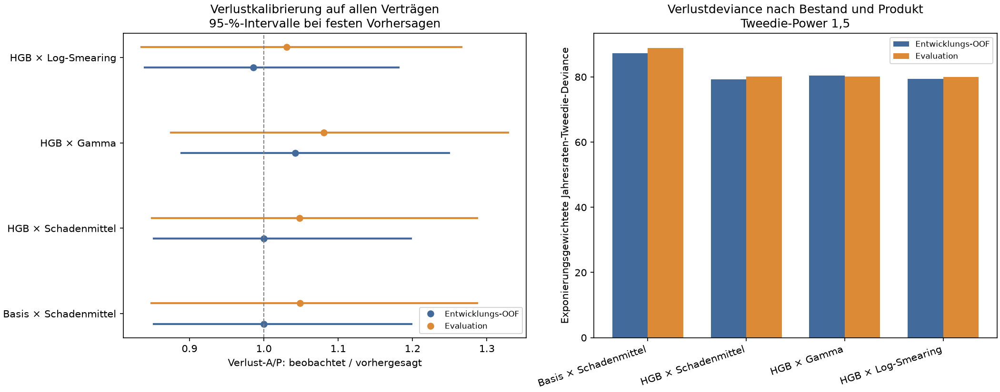

# Von der Exponierung zum erwarteten Schadenaufwand

Wie gut lassen sich Schadenanzahl und Schadenaufwand in einem Kfz-Haftpflichtportfolio vorhersagen? Die Studie verwendet **freMTPL2**, einen historischen französischen Versicherungsbestand. Sie vergleicht einen Exponierungs-Intercept mit Poisson-GLM, Spline-GAM und Histogramm-Boosting. Für den erwarteten Aufwand verbindet sie die Jahresfrequenz mit der erwarteten Höhe je positivem Schaden.

## Was die Modelle vorhersagen

Auf den **542.392 Entwicklungsverträgen** sinkt die Poisson-Deviance von **0,478094** beim Intercept auf **0,457123** beim besten GLM, **0,454637** beim besten GAM und **0,446749** beim Boosting. Alle Werte beziehen sich auf dieselben Entwicklungsverträge. Die Vorhersagen stammen jeweils aus einem Fit ohne den betreffenden Vertrag (Out-of-Fold, kurz OOF). Der Score ist auf die Exponierung in Vertragsjahren normiert. Beim Boosting liefert die Obergrenze von 15 Endknoten je Baum (`max_leaf_nodes=15`) den besten Wert der untersuchten Einstellungen. Die Option mit 31 Endknoten erzielt keinen zusätzlichen Gewinn. [Frequenzmodelle und Kalibrierung](docs/frequenzmodelle.md)

Die auf der Entwicklung gewählte Kombination aus Boosting und konstantem Schadenmittel senkt die Verlustdeviance in der **gemeinsamen Evaluation** um **9,80 %** gegenüber dem Intercept mit konstantem Schadenmittel. Auf den 135.599 Evaluationsverträgen prognostiziert sie **165,60 EUR je Vertragsjahr**, beobachtet werden **173,58 EUR**. Gamma-GLM und Log-Smearing erzielen etwas niedrigere Verlustscores in der Evaluation. Ihre gepaarten Differenzintervalle umfassen null. Das Gamma-GLM verbessert dort die separate Gamma-Deviance der positiven Schadenbeträge. [Ergebnistabelle](docs/ergebnisse.md) · [Schadenhöhe und reine Risikoprämie](docs/schadenhoehe_risikopraemie.md)

Der Vorhersagefehler ist je nach Vertragsdauer sehr unterschiedlich. Bei sieben Tagen bis unter 0,1 Vertragsjahren liegt der beobachtete Verlust beim **3,057-Fachen** der Vorhersage, ab einem Jahr beim **0,607-Fachen**. Große Schäden erschweren die Schätzung des Schadenmittels. Allein der größte Entwicklungsbetrag trägt **8,58 %** zum dort erfassten Verlust bei. [Bestandsanalyse](docs/eda.md)

## Welche Merkmale liefern zusätzliche Information?

Die Frequenz steigt im mittleren Alter auch bei gemeinsamem beobachtetem Merkmalsmix wieder an. Die Höhe dieses Anstiegs hängt vom Modell und der Referenzpopulation ab. Im explorativen Vergleich mit zwei Merkmalen erreicht das GAM aus Fahreralter und Bonus-Malus mit **82,028** den besten Verlustscore im untersuchten Kreis. Das vollständige Modell aus Boosting und konstantem Schadenmittel erreicht **79,195** auf denselben Entwicklungsverträgen. Trotz Überlappung verbessert Alter die Prognose zusätzlich zu Bonus-Malus. Zwei Merkmale ergeben eine einfacher erklärbare Tarifstruktur, kosten hier aber Prognoseleistung. Offen bleibt, wie stabil Alter und Bonus-Malus ihre jeweiligen Beiträge zum Risiko bei erneuter Anpassung behalten. [Merkmalswahl und aktuarische Einordnung](docs/aktuarische_einordnung.md)

Ein zweiter explorativer Vergleich untersucht, ob synthetische Trainingsverträge helfen, wenn pro Fold nur 20.000 reale Trainingsverträge zur Verfügung stehen. Alle sechs CTGAN-Varianten schneiden auf den realen Entwicklungs-OOF-Verträgen schlechter ab als beide Kontrollen. Dieser Befund gilt für das dokumentierte Trainingsbudget, den Generator und das verwendete Frequenz-GLM. [CTGAN-Pilot](docs/synthetische_trainingsdaten.md)

## Daten und Grenzen

Die Analyse verwendet [CASdatasets 1.2-1](https://github.com/dutangc/CASdatasets/blob/227fb56b8734bdb7c0327a41180e01d2ddaeaf26/man/freMTPL.Rd). Gezählt werden erfasste positive Schadenzeilen je Vertragsperiode. Exponierung misst die beobachtete Dauer in Vertragsjahren. Die Modellierung verwendet ungekappte Exponierungen und historische EUR. Der [Quellenvergleich](reports/s0/source_comparison.json) dokumentiert Abweichungen zu OpenML, darunter 195 dort nicht zuordenbare Schadenzeilen.

Vor der heutigen Aufteilung wurde der Gesamtbestand exploriert. Für den aktuellen Vergleich wurde jeder Vertrag fest der Entwicklung (80 %) oder der Evaluation (20 %) zugeteilt. Bei der Cross-Validation erhält jeder Entwicklungsvertrag eine Vorhersage aus einem Fit auf den übrigen vier Folds. Merkmale, Vorverarbeitung und Modellwahl werden innerhalb der Entwicklung beurteilt. Die gemeinsame Evaluation bewertet die zuvor festgelegten Regeln. Merkmalsablation und CTGAN-Pilot verwenden erneut die Entwicklung und sind explorativ. [Messgrößen und Validierung](docs/validierung.md)

Der Bestand stammt ungefähr aus den Jahren 2011–2013. Die Beträge enthalten französische Regulierungskonventionen. Eine Prüfung in späteren Zeiträumen, auf unabhängigen Daten und im deutschen Markt steht aus. Die reine Risikoprämie erfasst den modellierten Schadenbedarf. Ein Marktbeitrag hängt außerdem von Kosten, Sicherheitszuschlägen und Steuern ab.

## Analysen, Paper und Vortrag

- [Sieben Notebooks mit Tabellen und Grafiken](notebooks/README.md)
- [Begleitpaper als PDF](paper/begleitpaper.pdf) · [LaTeX-Quellen und Literatur](paper/README.md)
- [Hauptvortrag als PDF](slides/hauptvortrag.pdf) · [Backups](slides/backup.pdf) · [Sprechernotizen](slides/sprechernotizen.md)
- [Ergebnisse reproduzieren und Herkunft prüfen](docs/reproduktion.md)
- [Frühere Notebooks](notebooks/legacy/) · [Historische Modellgrafiken](figures/README.md) · [Historische EDA-Grafiken](reports/figs/README.md)

C. Dutang und A. Charpentier (2026), *CASdatasets: Insurance datasets*. [DOI 10.57745/P0KHAG](https://doi.org/10.57745/P0KHAG). Der [Datenvertrag](config/data_contract.json) und das [Quellenmanifest](reports/s0/source_manifest.json) dokumentieren Einheiten, Versionen und Nutzungsangaben. Der Projektcode steht unter [MIT](LICENSE). Für CASdatasets gelten die [Lizenzangaben der Quelle](https://github.com/dutangc/CASdatasets/blob/227fb56b8734bdb7c0327a41180e01d2ddaeaf26/DESCRIPTION).
