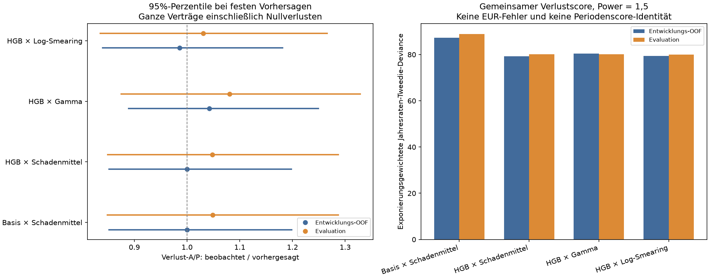

# Von der Exponierung zum erwarteten Schadenaufwand

Eine aktuarielle Modellierungsstudie zum französischen Kfz-Haftpflichtportfolio **freMTPL2**.

Wie viel der Vorhersagestruktur erfassen ein Poisson-GLM und ein Spline-GAM? Welchen zusätzlichen Nutzen liefert Histogramm-Boosting, und verbessert eine merkmalsabhängige Schadenhöhe auch die Vorhersage des gesamten Schadenaufwands?

Der Vergleich verwendet dieselben Vertragsaufteilungen, prospektive Merkmale und ungekappte Zielgrößen. Die vor der Evaluation gewählte Kombination aus **HGB-Frequenz und konstanter mittlerer Schadenhöhe** senkt die Verlustdeviance gegenüber der vollständigen Interceptbasis um **9,80 %**. Erhebliche Abweichungen nach Vertragsdauer und Alter sowie die Unsicherheit großer Schäden begrenzen die Anwendung als Tarif.

## Ergebnisse lesen

| Untersuchung | Inhalt und Nachweise |
|---|---|
| [Entwicklungs-EDA](docs/eda.md) | Alter, Bonus-Malus, Bestandsmix, kurze Exponierungen und große Schäden |
| [Frequenzmodelle](docs/frequenzmodelle.md) | Substantieller GLM-/GAM-Vergleich mit einem begrenzten Boosting-Benchmark |
| [Schadenhöhe und Risikoprämie](docs/schadenhoehe_risikopraemie.md) | Gamma-GLM, Log-Smearing, konstantes Schadenmittel und gemeinsame Evaluation |
| [Berechnete Kernergebnisse](docs/ergebnisse.md) | Automatisch erzeugte Tabelle und [kleines Ergebnis-JSON](reports/s6/results.json) für weitere Darstellungen |
| [Messgrößen und Validierung](docs/validierung.md) | Exponierung, Schlüsselzuordnung, Auswahlgrenzen und Unsicherheit |
| [Reproduktion](docs/reproduktion.md) | Vollständiger Ablauf, Umgebung, Laufkennungen und gemessener Ressourcenbedarf |

### Frequenz: Mehrwert flexibler Struktur

Zehn Konfigurationen einschließlich Intercept ergeben 50 echte Faltenfits auf 542.392 Entwicklungsverträgen. GLM und GAM bleiben ernsthafte Kandidaten; der größere Boosting-Baum verbessert die kleinere Einstellung nicht.

| Kandidat | OOF-Poisson-Deviance je Vertragsjahr | Reduktion zum Intercept | A/P |
|---|---:|---:|---:|
| Exponierungs-Intercept | 0,478094 | 0,00 % | 1,0000 |
| GLM, numerisches Familienminimum | 0,457123 | 4,39 % | 1,0000 |
| GAM, numerisches Familienminimum | 0,454637 | 4,91 % | 1,0000 |
| Histogramm-Poisson, `max_leaf_nodes=15` | 0,446749 | 6,56 % | 0,9996 |

[Berechnete Frequenzkennzahlen](reports/s4/scores.json), ursprünglicher Lauf `s4freq-4b7f4f42e310c304`. A/P bedeutet tatsächlich durch vorhergesagt. Auswahlwerte aus OOF sind keine unverzerrte Bewertung des gesamten abgestimmten Verfahrens.

Der erneute Frequenzanstieg im mittleren Alter bleibt auch unter gemeinsam unterstütztem beobachtetem Merkmalsmix sichtbar. Die Höhe ist modellabhängig; daraus folgt keine kausale Alterswirkung.

### Schadenhöhe: komplexer ist hier nicht automatisch besser

Die Entwicklungsentscheidung bevorzugt das arithmetische Trainingsschadenmittel gegenüber Gamma-GLM und Log-OLS mit Trainings-Smearing. Alle 135.599 Evaluationsverträge erhalten dieselbe prospektive Vorhersageregel, einschließlich der 130.499 Verträge ohne Verlust; 5.378 positive Schadenzeilen gehen in die Bewertung ein.

| Produkt | OOF-Verlustdeviance | Evaluations-Verlustdeviance | Verlust-A/P |
|---|---:|---:|---:|
| Intercept × Schadenmittel | 87,233849 | 88,917790 | 1,0488 |
| HGB × Schadenmittel (gewählt) | 79,194844 | 80,206534 | 1,0481 |
| HGB × Gamma | 80,386955 | 80,063797 | 1,0807 |
| HGB × Log-Smearing | 79,370343 | 80,026128 | 1,0308 |

Score: exponierungsgewichtete Jahresraten-Tweedie-Deviance mit fester Power 1,5. [Berechnete Verlustkennzahlen](reports/s5/evaluation_loss_scores.json), Lauf `s5sev-2c4bc0d8ad1fd1c1`. Die etwas besseren Evaluationsscores anderer Varianten führen zu keiner nachträglichen Neuwahl; ihre bedingten gepaarten Differenzintervalle enthalten null. Das Gamma-Modell verbessert die separate Schaden-Gamma-Deviance in der Evaluation, weshalb das Ergebnis keine allgemeine Aussage gegen Schadenhöhenmerkmale ist.

Das gewählte Produkt prognostiziert **165,60 EUR je Vertragsjahr**, beobachtet werden **173,58 EUR**. Verlust-A/P beträgt dagegen etwa **3,057** bei sieben Tagen bis unter 0,1 Vertragsjahren und **0,607** ab einem Jahr. Der größte Entwicklungsschaden trägt **8,58 %** der Verlustsumme; ein Entwicklungsrefit ohne dessen gesamten Vertrag verändert die Portfoliovorhersage um etwa **6–9 %**. Diese Sensitivität rechtfertigt keine automatische Kappung.



## Daten, Zielgröße und Modellannahmen

Verwendet wird **CASdatasets 1.2-1**, Commit [`227fb56b8734bdb7c0327a41180e01d2ddaeaf26`](https://github.com/dutangc/CASdatasets/commit/227fb56b8734bdb7c0327a41180e01d2ddaeaf26). Die Zielgröße zählt erfasste positive Schadenzeilen je Vertragsperiode. Sie bezeichnet weder sämtliche gemeldeten Schäden noch alle wirtschaftlichen Verluste.

Der [Quellenvergleich](reports/s0/source_comparison.json) zeigt, weshalb die Version relevant ist:

| Größe | CASdatasets, festgelegter Commit | OpenML 41214/41215, Version 1 |
|---|---:|---:|
| Vertragszeilen | 677.991 | 678.013 |
| Exponierung in Vertragsjahren | 358.482,835463 | 358.499,445463 |
| Mitgelieferte Schadenanzahl | 26.444 | 36.102 |
| Verknüpfte positive Schadenzeilen | 26.444 | 26.444 |
| Verknüpfte Beträge, historische EUR | 59.909.216,50 | 59.909.216,50 |
| Nicht zuordenbare Schadenzeilen | 0 | 195 |

Die 195 nicht zuordenbaren OpenML-Zeilen umfassen 788.714,18 EUR. Bei 9.095 gemeinsamen Verträgen unterscheidet sich die mitgelieferte Anzahl; der Vergleich erklärt die Ursache nicht. CAS-Anzahl und rekonstruierte Zeilenanzahl stimmen überein. Beide bleiben getrennt gespeichert. Exponierungen, Anzahlen und Beträge werden primär nicht gekappt; keine Vertrags- oder Schadenzeile wird ausgeschlossen.

`Exposure` misst Vertragsjahre. Frequenzmodelle prognostizieren Jahresraten; erwartete Periodenanzahlen sind Exponierung × Rate. Schadenhöhe wird mit Gewicht eins pro positiver Trainingsschadenzeile und ohne Exponierungsoffset angepasst. Jahresrisikoprämien entstehen je Vertrag als Frequenz × Schadenhöhe; erst danach werden die erwarteten Periodenbeträge aggregiert. Dafür genügt die bedingte Mittelwertannahme `E[S | N,x,e] = N*m(x)` zusammen mit `E[N | x,e] = e*r(x)` bei geeigneten endlichen Momenten. Der Zeilenabgleich belegt diese Annahme nicht.

Die feste schlüsselbasierte Aufteilung verwendet 80 % Entwicklung mit fünf Falten und 20 % Evaluation. Jede Schadenzeile folgt ihrem Vertrag. Encoder, Skalierung, Splines und Smearing werden ausschließlich im jeweiligen Training gelernt. Die ursprüngliche Analyse hatte den gesamten Datenstand betrachtet; die neue Evaluation ist daher keine externe oder historisch unberührte Validierung. Es fehlen zudem belastbare Zeit-, Haushalts-, Nutzungs- und Beendigungsinformationen. Bootstrap-Intervalle bei festen Vorhersagen erfassen keine erneute Anpassung, Auswahl oder bislang unbeobachtete Extremverluste.

## Vollständig ausführen

Geprüft wird Windows x64 mit CPython 3.12 und den [festgelegten Paketversionen](requirements.lock.txt). In einem separaten frischen Clone:

```powershell
py -3.12 -m venv .venv
.\.venv\Scripts\python.exe -m pip install -r requirements.lock.txt
.\.venv\Scripts\python.exe scripts/reproduce.py --fresh
.\.venv\Scripts\python.exe scripts/build_results.py --check
```

Der letzte Workflow lädt die festgelegten CAS-Dateien herunter, prüft sie vor dem Lesen und führt Vorbereitung, Aufteilung, EDA, sämtliche Modelle, Evaluation, Abbildungen und alle fünf [aktiven Notebooks](notebooks/README.md) in frischen Kerneln aus. Rohdaten, Modelle, Vorhersagen und ausgeführte Notebookkopien liegen unter `data/` und bleiben lokal. Die Ausführung schreibt aktuelle aggregierte Berichte in diesem Clone. `--fresh` verlangt leere Analysecaches und löscht nichts. Ein erneuter Download des historischen OpenML-Vergleichs ist dafür nicht erforderlich.

Linux/macOS sind noch nicht ausgeführt. Dort ist die direkte [Abhängigkeitsliste](requirements.txt) der Ausgangspunkt; Paketauflösung und Ergebnisse müssen gesondert geprüft werden. Der [Reproduktionsnachweis](docs/reproduktion.md) beschreibt die tatsächlich geprüfte Plattform und die Grenzen der Bytegleichheit zwischen Softwareständen.

## Bezug zur Referenz und Grenzen der Übertragung

Die Zerlegung in Poisson-Frequenz, positive Schadenhöhe und deren Produkt folgt dem [scikit-learn-Versicherungsbeispiel](https://scikit-learn.org/stable/auto_examples/linear_model/plot_tweedie_regression_insurance_claims.html). Diese Studie verwendet einen eigens abgeglichenen CAS-Datenstand, ein ungekapp­tes Zeilenziel, ganze Vertragsfalten, trainingsweise Vorverarbeitung und eine begrenzte GLM-/P-Spline-GAM-/Boosting-Gegenüberstellung. Der direkte Tweedie-Regressor des Beispiels gehört nicht zum registrierten Kandidatenumfang. Eigene Prüfungen von Gradienten, Strafen, Metriken und Vorhersageausrichtung ersetzen keine externe Validierung.

Die [Anbieterbeschreibung](https://github.com/dutangc/CASdatasets/blob/227fb56b8734bdb7c0327a41180e01d2ddaeaf26/man/freMTPL.Rd) nennt einen unbekannten privaten Versicherer, ungefähr 2011–2013 und teilweise feste IRSA-IDA-Regulierungsbeträge. Die historischen französischen EUR sind keine heutigen deutschen Schadenkosten. Kosten, Sicherheitszuschläge, Steuern, Wettbewerb und Vertriebsverhalten werden nicht modelliert; die reine Risikoprämie ist kein Marktpreis.

Quellenangabe: C. Dutang und A. Charpentier (2026), *CASdatasets: Insurance datasets*, [DOI 10.57745/P0KHAG](https://doi.org/10.57745/P0KHAG). [Quellenmanifest](reports/s0/source_manifest.json) und [Datenvertrag](config/data_contract.json) halten Quelle, Nutzungsangaben und Einheiten fest. Projektcode: [MIT](LICENSE). CASdatasets deklariert [GPL ≥2](https://github.com/dutangc/CASdatasets/blob/227fb56b8734bdb7c0327a41180e01d2ddaeaf26/DESCRIPTION); die beiden OpenML-Metadaten deklarieren CC0. Die Projektlizenz lizenziert Quelldaten nicht um.

Die ursprünglichen [Notebooks](notebooks/legacy/), [Abbildungen](figures/README.md) und [EDA-Bilder](reports/figs/README.md) bleiben als historische Analyse erhalten. Dazu gehören auch der alte [GLM-Helfer](src/features_glm.py) und die [frühere Metrikimplementierung](src/legacy/metrics.py). Ihre alten Kennzahlen und Grafiken sind keine bestätigten Resultate des aktuellen Ablaufs.
