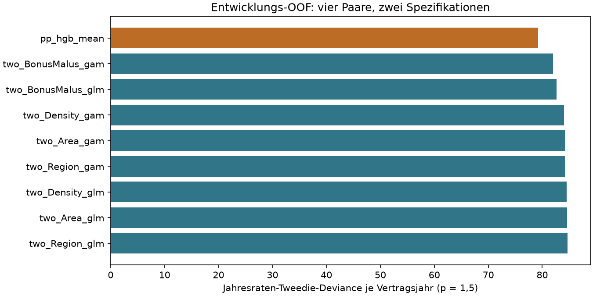
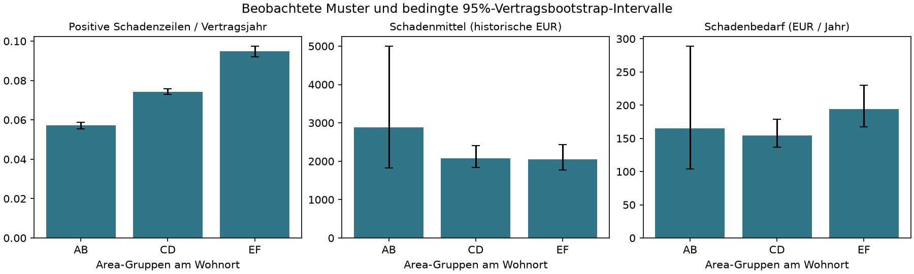
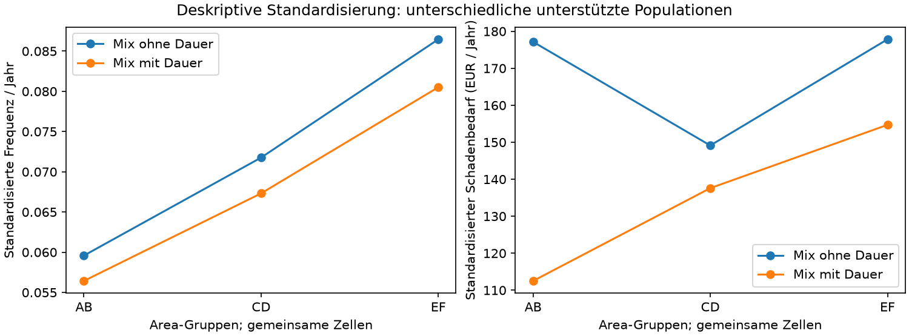

# Zwei Tarifmerkmale und die Erklärung des Schadenbedarfs

Wie viel Information geht bei einer Beschränkung auf zwei Tarifmerkmale verloren, und welche beobachteten Muster tragen eine aktuarische Erklärung? Die Empfehlung dieser Untersuchung gilt für vier Paare mit Fahreralter. Sie ist keine Suche über sämtliche Kombinationen und kein unmittelbar einsetzbarer Tarif.

## Daten, Ziel und Einheiten

Die [gepinnte CAS-Dokumentation](https://github.com/dutangc/CASdatasets/blob/227fb56b8734bdb7c0327a41180e01d2ddaeaf26/man/freMTPL.Rd) beschreibt einen unbekannten privaten französischen Versicherer, ungefähr 2011–2013. `Area` bezeichnet ein Wohngebiet von A bis F, `Density` die Einwohnerdichte am Wohnort und `Region` eine historische Vertragsregion. Keines ist der Unfallort. `DrivAge` identifiziert nicht zwingend den Unfallfahrer. Teilweise beruhen Beträge auf der IRSA-IDA-Konvention; sie messen nicht unmittelbar physische Unfallschwere.

Die Hauptanalyse behält sämtliche positiven Schadenzeilen, Nullschadenverträge, ungekappte Vertragsjahre und historische EUR. Der [Datenabgleich](../reports/s0/source_comparison.json) und die [Gesamtstudie](ergebnisse.md) bleiben ihre Grundlage. Neue Vergleiche verwenden ausschließlich die eingefrorene Entwicklung. Die gemeinsame vorbereitete Datei enthält auch Evaluationsverträge; diese werden vor jeder S6a-Auswertung anhand ihrer Schlüssel ausgefiltert. Evaluationsvorhersagen werden hierfür nicht gelesen. Die S5-Evaluation ist bereits geöffnet: Die neue Untersuchung ist explorative Entwicklungsarbeit und ändert die gesperrte S5-Entscheidung nicht.

Je Vertrag gilt `q_i=r_i*m_i` in EUR/Jahr und `C_i=e_i*q_i` in EUR je Periode. Erst Vertragsprodukte werden summiert. `sum(C_i)/sum(e_i)` ist der jährliche Schadenbedarf, `sum(C_i)/sum(e_i*r_i)` die vorhergesagte claimgewichtete Schadenhöhe. Ein Produkt separat exponierungsgewichteter Komponentenmittel ist im Allgemeinen etwas anderes. Die Zerlegung benötigt etwa `E[S | N,x,e]=N*m(x)` und `E[N | x,e]=e*r(x)` sowie geeignete endliche Momente. Der Abgleich von Schadenzeilen und Anzahlen beweist diese bedingte Mittelwertannahme nicht.

## Der begrenzte Modellvergleich

Die [vor den Fits registrierte Spezifikation](../config/interpretation_protocol.json) legt vier Paare fest: `DrivAge + Area`, `DrivAge + log(Density)`, `DrivAge + Region`, `DrivAge + BonusMalus`. Je Paar werden ein Poisson-GLM und ein additives Poisson-Spline-GAM auf denselben fünf OOF-Folds berechnet. Dummy- und Spline-Spalten zählen zu ihrem Ursprungsmerkmal. Exponierung skaliert die Periodenerwartung und dient als Gewicht.

Das GLM verwendet feste Alters-/BM-Grenzen, Referenzkodierung und einen linearen, trainingsweise standardisierten logarithmischen Dichteterm. Das reduzierte GAM verwendet kubische B-Splines mit acht uniformen Trainingsbereichsknoten, exponierungsgewichteter Zentrierung und Ridge-Strafe `alpha=0.0001` auf nichtkonstante Koeffizienten. Diese Strafe unterscheidet sich von der Differenzenstrafe des vollständigen S4-GAM. Beide sind transparente begrenzte Spezifikationen; eine optimale Glättung oder gleiche Komplexität wird nicht behauptet. [PoissonRegressor](https://scikit-learn.org/stable/modules/generated/sklearn.linear_model.PoissonRegressor.html) und [SplineTransformer](https://scikit-learn.org/stable/modules/generated/sklearn.preprocessing.SplineTransformer.html) dokumentieren die APIs.

Kategorien, Skalierung und Splines werden nur im Trainingsfold gelernt. Unbekannte Faktoren verwenden die Trainingsreferenz; numerische Werte außerhalb des Trainingsbereichs werden protokolliert. Spline-Ränder werden konstant fortgesetzt. Die Schadenhöhe ist bei allen acht Regeln das arithmetische Mittel sämtlicher positiver **Trainingsschadenzeilen** je Fold. Auch Nullschadenverträge erhalten diese Regel. Das Budget umfasst 40 Frequenzfits und fünf Schadenmittel, ohne Hyperparametersuche oder neue Vollbestandsrefits.

Der [vollständige Schadenhöhenvergleich](schadenhoehe_risikopraemie.md) untersucht daneben ein Gamma-GLM und ein Logmodell mit trainingsweise geschätztem Smearing. Ein Log-Fit modelliert nicht unmittelbar den arithmetischen Schadenmittelwert; die Rücktransformation benötigt passende Annahmen über das bedingte Fehlerverhalten. Diese vollständigen Modelle werden hier nicht in die reduzierte Regel eingeschleust. Der [Frequenzvergleich](frequenzmodelle.md) begründet GLM, GAM und den einen nichtadditiven Benchmark anhand ihrer tatsächlich gemessenen Entwicklungsleistung.

Hauptkriterium ist `sum(e_i*d_1.5(S_i/e_i,q_i))/sum(e_i)` mit fester Tweedie-Power 1,5. Vollständige Referenz sind die unveränderten Entwicklungs-OOF-Produkte `pp_hgb_mean` aus S5. Frequenzdeviance, Claim-Gamma-Deviance, A/P, Segmente und Falten ergänzen den Vergleich. Die 500 gepaarten ganzen Vertragsziehungen verwenden gemeinsame Indizes und den gezogenen Exponierungsnenner. Ihre 95%-Perzentilintervalle enthalten keine erneute Anpassung, Auswahlunsicherheit oder unbekannte Haushaltsabhängigkeit.

Der empirische Bootstrap kann zudem noch nicht beobachtete Extremverluste nicht darstellen. Seine Intervalle sind keine umfassenden Prämien- oder Reserveunsicherheitsintervalle.

### Ergebnis und Empfehlung

Lauf `s6af633eebaf65aa470` verwendet 542.392 Entwicklungsverträge, 286.880,82 Vertragsjahre und 21.066 positive Schadenzeilen mit 47.480.754,65 historischen EUR. Alle Kandidaten prognostizieren dieselben Verträge, darunter 522.548 Nullschadenverträge. Quelle `cas-744e13a80283a07a`, Split `s2split-fe11d414168572dd`. [Scores](../reports/s6a/scores.json), [Foldmengen und Trainingsclaims](../reports/s6a/report.json).

| Zwei Ursprungsmerkmale | GLM: Jahresraten-Deviance | GAM: Jahresraten-Deviance |
| --- | --- | --- |
| Fahreralter + Area | 84,620291 | 84,181046 |
| Fahreralter + log(Density) | 84,503809 | 84,057302 |
| Fahreralter + Region | 84,667702 | 84,216007 |
| Fahreralter + Bonus-Malus | 82,620512 | 82,027856 |

**Im registrierten Kreis empfehle ich Fahreralter und Bonus-Malus mit dem reduzierten Spline-GAM.** Sein Score beträgt 82,027856 gegenüber 79,194844 beim vollständigen OOF-Modell: 3,58 % höher. Die gepaarte Scoreverschlechterung beträgt 2,833012, bedingtes 95%-Intervall [1,462608; 4,807079]. Unter den acht reduzierten Regeln gewinnt das BM-GAM zwei Fold-Punktvergleiche, das BM-GLM die übrigen drei. Das vollständige Modell liegt in allen fünf Folds vor sämtlichen reduzierten Regeln. Nach der vorab festgelegten 0,5%-Nähe-Regel liegt nur `two_BonusMalus_gam` im engsten Kandidatenkreis. Das ist keine globale Paaroptimalität. [Gepaarter Vergleich zur vollständigen Regel](../reports/s6a/bootstrap_full.json), [Falten](../reports/s6a/fold_scores.json).

Der Punktabstand des BM-GLM zum BM-GAM beträgt 0,592656, sein bedingtes Intervall [-0,188276; 1,959059]. Das Intervall enthält null: Der Vorteil des GAM gegenüber dem BM-GLM ist damit unter dieser bedingten Unsicherheitsbetrachtung nicht eindeutig getrennt. Die Paarwahl ist belastbarer als eine eindeutige Rangbehauptung zwischen diesen beiden Spezifikationen. Diese Intervallinformation ergänzt die praktische Nähe-Regel; sie korrigiert nicht für nachträgliche Auswahl. Das Portfolio-A/P des empfohlenen Modells ist 1,000146. Fast exakte Gesamtbalance ersetzt weder Segmentkalibrierung noch eine unabhängige Validierung. Das konstante Trainingsclaim-Mittel begrenzt alle reduzierten Regeln besonders dort, wo Schadenhöhen stark variieren. [Claim-Score](../reports/s6a/severity_scores.json), [Segmentkalibrierung](../reports/s6a/geography_calibration.json).




## Beobachtung und adjustierte Assoziation

Die vorab festgelegten geografischen Gruppen heißen AB, CD und EF; ursprüngliche Area-Stufen, Dichteklassen, Regionen und Alterskombinationen bleiben in den Tabellen erhalten. Median/p90/p99 betreffen positive Schadenzeilen; Frequenz und Schadenbedarf alle Verträge. Schäden ab 10.000 und 100.000 EUR zeigen den Tail-Einfluss. Gekappte Beträge sind ausdrücklich alternative Sensitivitätsziele.

Die gemeinsame Unterstützung kombiniert Altersgruppe, BM-Gruppe, Fahrzeugalter und Kraftstoff. Die Daueranalyse ergänzt Gruppen bis 0,25, über 0,25 bis 0,75 und über 0,75 Jahre. Jede behaltene Zelle benötigt in **jeder** geografischen Gruppe mindestens 100 Vertragsjahre und zehn positive Schadenzeilen. Alle Gruppen erhalten dieselben gepoolten Exponierungsgewichte der behaltenen Zellen. Area und Density bleiben auf beobachteten Verträgen gemeinsam erhalten. Das belegt grobe gemeinsame Unterstützung, keine kontinuierliche Positivität. Mit und ohne Dauer werden unterschiedliche unterstützte Populationen untersucht; ihre Differenz ist kein isolierter Daueradjustierungseffekt.

Die vollständigen GLM-/GAM-Entwicklungsrefits liefern auf diesen beobachteten Verträgen ergänzende standardisierte Frequenzprofile: adjustierte Modellassoziationen, keine OOF-Gütescores. Ihre Intervalle halten Unterstützung, Referenzmix und Modelle fest. Dauer kann mit Vertragsbeendigung, Schadenmeldung oder ungemessener Nutzung zusammenhängen. Sie wird diagnostisch untersucht und nicht als drittes Tarifmerkmal eingeführt.

Standardisiert werden die genannten groben Zellen. Region, VehBrand, VehPower und die exakten Merkmalsverteilungen innerhalb einer Zelle bleiben gruppenspezifisch. Die Profile sind daher standardisierte vorhergesagte Gruppenraten und keine isolierten Area-Partialeffekte bei ansonsten identischem vollständigem Merkmalsmix.

## Welche Mechanismen lassen sich unterscheiden?

### Beobachtete Geografie und gemeinsame Unterstützung

| Area-Gruppe | Verträge | Vertragsjahre | Claims | Frequenz/Jahr | Claimmittel EUR | Median EUR | Schadenbedarf EUR/Jahr | Betragsanteil ab 100.000 EUR |
| --- | --- | --- | --- | --- | --- | --- | --- | --- |
| AB | 143587 | 83.974,02 | 4806 | 0,05723 | 2.878,60 | 1.172,00 | 164,75 | 43,15 % |
| CD | 274750 | 145.362,17 | 10805 | 0,07433 | 2.078,73 | 1.172,00 | 154,52 | 18,24 % |
| EF | 124055 | 57.544,62 | 5455 | 0,09480 | 2.050,50 | 1.172,00 | 194,38 | 15,99 % |

Die drei Gruppen haben denselben Median von 1.172 EUR, aber verschiedene Mittelwerte und Tail-Anteile. Ein kleinerer Mittelwert ist damit kein Beleg für viele kleine Stadtunfälle. Feste Zahlbeträge sind mit der dokumentierten Konventionsabrechnung vereinbar; einzelne 1.172-EUR-Zeilen werden hier keiner Konvention nachweislich zugeordnet. [Gesamte Verteilungen und Sensitivitäten](../reports/s6a/geo.json), [Area × Alter](../reports/s6a/Area_age.json), [Wohnortdichte](../reports/s6a/density.json), [Regionen](../reports/s6a/Region.json).

| Area-Gruppe | Alter¹ | BM¹ | Fahrzeugalter¹ | Diesel¹ | B12¹ | mittlere Dauer² | Dauer bis 0,25 Jahre² |
| --- | --- | --- | --- | --- | --- | --- | --- |
| AB | 47,89 | 55,91 | 8,39 | 56,07 % | 13,27 % | 0,585 | 27,84 % |
| CD | 47,18 | 57,69 | 7,55 | 46,61 % | 17,38 % | 0,529 | 32,99 % |
| EF | 46,12 | 60,77 | 6,78 | 37,70 % | 26,60 % | 0,464 | 38,29 % |

¹ Exponierungsgewichtete Merkmalsmittel beziehungsweise Exponierungsanteile; ² Vertragsmittel beziehungsweise Vertragsanteile. B12 ist eine unbekannte Markengruppe und kein beobachteter Fahrzeugpreis oder Hinweis auf eine bestimmte Fahrzeugklasse.

Gemeinsame Unterstützung ohne Dauer: 48 gemeinsame Zellen, 501.612 Verträge, 271.366,20 Vertragsjahre; mit Dauer: 79 gemeinsame Zellen, 389.468 Verträge, 246.801,56 Vertragsjahre. [Unterstützung ohne Dauer](../reports/s6a/support_without_duration.json), [mit Dauer](../reports/s6a/support_with_duration.json). Die auf diesen tatsächlich behaltenen Verträgen ausgewiesenen [Verteilungen ohne Dauer](../reports/s6a/common_geo_without_duration.json) und [mit Dauer](../reports/s6a/common_geo_with_duration.json) ergänzen Claims, Quantile und Tail-Anteile; [Alter × Geografie](../reports/s6a/common_geo_age_with_duration.json) macht ihre Unterstützung sichtbar.

| Standardisierung | Gruppe | Frequenz/Jahr | Schadenbedarf EUR/Jahr | implizites Claimmittel EUR | GLM-Frequenzprofil | GAM-Frequenzprofil |
| --- | --- | --- | --- | --- | --- | --- |
| ohne Dauer | AB | 0,05958 | 177,15 | 2.973,20 | 0,05849 | 0,05833 |
| ohne Dauer | CD | 0,07176 | 149,13 | 2.078,05 | 0,07184 | 0,07160 |
| ohne Dauer | EF | 0,08647 | 177,83 | 2.056,55 | 0,08474 | 0,08409 |
| mit Dauer | AB | 0,05643 | 112,51 | 1.993,73 | 0,05708 | 0,05691 |
| mit Dauer | CD | 0,06732 | 137,59 | 2.043,98 | 0,07011 | 0,06981 |
| mit Dauer | EF | 0,08051 | 154,70 | 1.921,53 | 0,08316 | 0,08237 |

Das implizite Claimmittel ist standardisierter Schadenbedarf geteilt durch standardisierte Frequenz, kein einfacher Mittelwert der Gruppenschadenmittel. Beobachtete und vorhergesagte Summen werden je Zelle zunächst durch deren Exponierung geteilt, danach mit identischen Referenzgewichten aggregiert. [Standardisierte Werte ohne Dauer](../reports/s6a/standardized_without_duration.json), [mit Dauer](../reports/s6a/standardized_with_duration.json).

| Unterstützung | Kontrast EF minus AB | Punktwert | bedingtes 95%-Intervall |
| --- | --- | --- | --- |
| ohne Dauer | Frequenz | 0,02689 | [0,02341; 0,03046] |
| ohne Dauer | Schadenbedarf EUR/Jahr | 0,68 | [-146,67; 90,02] |
| mit Dauer | Frequenz | 0,02408 | [0,02097; 0,02718] |
| mit Dauer | Schadenbedarf EUR/Jahr | 42,19 | [7,78; 87,20] |

Die Kontrastintervalle sind direkt aus gepaarten Vertragsziehungen berechnet; ein Vergleich überlappender Einzelintervalle wäre etwas anderes. [Intervalle ohne Dauer](../reports/s6a/standardized_intervals_without_duration.json), [mit Dauer](../reports/s6a/standardized_intervals_with_duration.json). Unterstützung wurde auch anhand beobachteter Claimzahlen gewählt; die Unsicherheit hält diese Zellen und ihren Referenzmix fest. Unterschiede zwischen den beiden Populationen dürfen nicht als reine Dauerwirkung bezeichnet werden.





| Hypothese und erwartete Beobachtung | Diagnose und tatsächlicher Befund | Konkurrenz / Status | Benötigte Zusatzdaten |
|---|---|---|---|
| Dichteres Wohnumfeld geht über andere Fahrten oder mehr Verkehrskontakte mit mehr erfassten Schäden je Jahr einher. Erwartet: höhere Frequenz in EF auch bei ähnlichem beobachtetem Mix. | EF liegt im gemeinsamen Mix über AB; auch mit Dauergruppen bleibt der Frequenzkontrast positiv. Die vollständigen GLM-/GAM-Profile zeigen ebenfalls einen Gradienten. | Das **Muster** ist unterstützt; Kontaktmechanismus, Kilometerleistung, Meldeverhalten und Bestandsselektion werden nicht unterschieden. | Kilometer/Nutzungszweck, Fahrten, Unfallort/-art, Meldewahrscheinlichkeit und Deckung. |
| Höhere außerörtliche Geschwindigkeit könnte die physische Schwere erhöhen. Erwartet: schwerere Verletzungen bei entsprechenden Unfallorten; ein stabiler Versicherungsbetragsgradient wäre nur indirekt kompatibel. | AB hat einen höheren rohen Claimmittelwert; alle Gruppen denselben Median. Ohne Dauer liegt das standardisierte AB-Mittel bei etwa 2.973 EUR, mit Dauer bei etwa 1.994 EUR auf anderer Unterstützung; EF bei etwa 2.057 beziehungsweise 1.922 EUR. | Ein stabiler allgemeiner Schadenhöhenmechanismus wird durch diese Sensitivität **abgeschwächt**. Geschwindigkeit bleibt extern plausibel, im Portfolio **nicht identifiziert**. Tail, Abrechnung und Auswahl sind Alternativen. | Unfallort/Straße, Geschwindigkeit, Personenschaden, Haftungs-/Regulierungsdaten. |
| Dokumentiertes Alter bildet Erfahrung oder Nutzung ab. Erwartet bei einer reinen monotonen Erfahrungsgeschichte: nach ähnlichem Mix stetig sinkende Frequenz. | S4-Profile auf gemeinsam unterstützten Altersbereichen zeigen im GAM bei zugewiesenem Alter 35/45/55 die Raten 0,052486/0,077730/0,074113; GLM 0,064506/0,081771/0,072271. 291.234 Referenzverträge mit 163.403,34 Vertragsjahren. Die bestehenden Kontrastintervalle benachbarter mittlerer Altersgruppen sind breit. | Eine einfache monotone Erfahrungserklärung reicht **nicht aus**. Adjustierte Altersassoziation ist vorhanden, Unfallfahrer, Erfahrung und Nutzung sind nicht getrennt beobachtet. | Tatsächlicher Unfallfahrer, Führerscheindauer, Kilometer, Nutzung und zeitliche Schadenhistorie. |
| Unterschiedliche Vertragsdauer und Selektion erzeugen Teile der Geografiemuster. Erwartet: kurzer Dauerbestand mit anderem Mix und abweichenden Jahresraten. | Mittlere Dauer sinkt von AB über CD nach EF; Dauersegment-Kalibrierung und gemeinsame Dauerzellen werden separat gezeigt. Der Frequenzgradient bleibt, Verlust- und Claimmittelrelationen reagieren stärker. | Dauer-/Selektionsalternativen sind **relevant**, erklären aber nicht automatisch den gesamten verbleibenden Gradienten. Wechselnde Unterstützung verhindert eine kausale Zerlegung. | Beginn/Ende und Beendigungsgrund, Unfall-/Meldedatum, Nutzung, mehrjährige Bestandsverläufe. |

Die Altersprofile sind unveränderte S4-Entwicklungsrefits mit grober gemeinsamer BM-/Fahrzeug-/Kraftstoff-/Regionsunterstützung; kein kausales Altern derselben Person und keine OOF-Scorekurve. [Altersprofile](../reports/s6a/existing_age_profiles.json), [bestehende Kontrastintervalle](../reports/s6a/existing_age_contrasts.json), [Dauer-/Geografiekalibrierung](../reports/s6a/geography_calibration.json). Diese Befunde liefern keine Unfallartgeschichte. Auch Bonus-Malus als nützliches Prognosemerkmal belegt weder einen Verhaltenseffekt der Tarifierung noch seine generelle Marktunverzichtbarkeit.


Ein kausaler Vergleich benötigt eine definierte Intervention sowie begründete Konsistenz-, Austauschbarkeits- und Unterstützungsannahmen; [Hernán und Robins (2006)](https://pmc.ncbi.nlm.nih.gov/articles/PMC2652882/) erläutern diese Unterscheidung. Eine Geschwindigkeitsregel ist anders definierbar als „dieselbe Person älter machen“ oder „ländlicher wohnen“, ohne veränderte Fahrten und Lebensumstände festzulegen. Eine denkbare Kette wäre Wohnumfeld → Fahrten/Geschwindigkeit → Unfall → Betrag. Fahrleistung, Fahrzeugwahl und Vertragsselektion könnten mehrere Größen zugleich beeinflussen. Diese Pfeile sind Annahmen. Bonus-Malus kann Erfahrung und vergangene Schäden abbilden, auf einem früheren Wirkungspfad liegen oder mit Selektion zusammenhängen. Seine Rolle hängt von der zeitlichen Frage ab; er ist nicht pauschal ein Confounder. Die Beschränkung der Schadenhöhenanalyse auf positive Claims kann weitere Selektion erzeugen.

### Externe Evidenz und ihre Übertragungsgrenzen

Die [ONISR-Statistik 2024](https://www.onisr.securite-routiere.gouv.fr/etat-de-linsecurite-routiere/bilans-annuels-de-la-securite-routiere/bilan-2024-de-la-securite-routiere) ordnet 60 % der Verkehrstoten und 47 % der Schwerverletzten Straßen außerorts zu. Das sind Anteile ohne passenden Kilometer-/Vertragsnenner, keine Schadenmittel ländlich wohnender Versicherter. Personen aller Verkehrsarten in Frankreich métropolitaine 2024 sind ein anderer Bestand und Zeitraum. Der [Bericht für 2012](https://www.onisr.securite-routiere.gouv.fr/etat-de-l-insecurite-routiere/bilans-annuels-de-la-securite-routiere/bilan-2012-de-la-securite-routiere) liegt zeitlich näher, misst aber ebenfalls Personenschadenunfälle. Widersprüchliche Gesamtzahlen auf seiner Übersichtsseite werden nicht numerisch übernommen.

Die originäre [Cerema-Evaluation der 80-km/h-Regel](https://www.cerema.fr/en/actualites/lowering-maximum-authorised-speed-80-kmh-final-assessment) vergleicht betroffene französische Straßen vor und nach Juli 2018 mit dem übrigen Straßennetz als Kontrolle, hauptsächlich bis Dezember 2019. Berichtet werden geringere gefahrene Geschwindigkeiten und geringere Mortalität. Das stützt Geschwindigkeit als plausible Einflussgröße **physischer** Unfallschwere. Es identifiziert weder den Geschwindigkeitsmix der freMTPL2-Verträge noch die Ursache ihrer Zahlbeträge. Es handelt sich um eine beobachtende Maßnahmenevaluation mit eigenen Vergleichsannahmen, kein randomisiertes Experiment im Versicherungsbestand.

Benötigt werden Unfallort/Straßentyp, Unfallart, Geschwindigkeit, Kilometer/Nutzungszweck, tatsächlicher Unfallfahrer, Personenschadenindikator sowie Unfall-, Melde- und Regulierungszeitpunkte. Deckung, Haftungsanteile und Konventionsabrechnung müssten dazu passen. Diese Verknüpfung könnte konkurrierende Erklärungen gezielt prüfen. Die [Quellenübersicht](../reports/s6a/sources.json) hält Gegenstand und Grenzen fest.

## Vom Schadenbedarf zur Prämie

Beide Szenarien setzen ausdrücklich jährliche Kosten an. Ohne weitere Lasten und Steuern: `P_fix=q+50` und aus `P_var=q+0.15*P_var` daher `P_var=q/0.85`. Ein Kostenanteil an der finalen Prämie ist kein 15%-Aufschlag auf q. Der Schnittpunkt beträgt `q=850/3=283,33… EUR/Jahr`. Darunter ist das variable Szenario günstiger, darüber die Pauschale. Dies ist eine Preisrelation unter angenommenen Kostenregeln, kein Profitabilitätsnachweis.

| Fahreralter | Bonus-Malus | Verträge | Vertragsjahre | q EUR/Jahr | P_fix EUR/Jahr | P_var EUR/Jahr |
| --- | --- | --- | --- | --- | --- | --- |
| 25–34 | 50 | 14590 | 8.746,32 | 86,98 | 136,98 | 102,33 |
| ab 65 | 51–75 | 6671 | 3.967,17 | 187,43 | 237,43 | 220,51 |
| ab 65 | 76–100 | 1976 | 990,34 | 337,72 | 387,72 | 397,32 |
| 35–49 | ab 101 | 1207 | 577,94 | 760,11 | 810,11 | 894,25 |

Die Beispiele verteilen sich über die unterstützten berechneten Risikogruppen; alle Gruppen stehen in [costs.json](../reports/s6a/costs.json). Die Gruppenwerte sind durchschnittliche OOF-Risikoprämien, keine unabhängig geschätzten beobachteten Zellmittel.


Die Gruppen verwenden exponierungsgewichtete OOF-Vertragsprodukte des empfohlenen reduzierten Modells. Schäden und Schadenregulierungskosten sind abzugrenzen, damit Aufwand nicht doppelt geladen wird. Mit zusätzlich definierten jährlichen festen Kosten F, Risiko-/Kapitallast R, Gewinnbetrag G und variablem Anteil v wäre eine mögliche Nettopreisregel `P=(q+F+R+G)/(1-v)`. Ein angenommener Steuersatz t würde bei passender Bemessungsbasis `P*(1+t)` ergeben. Hier werden keine tatsächlichen Kosten, Kapitallasten oder Steuersätze geschätzt.

Bei gleichem q und tatsächlich niedrigeren zurechenbaren Kanalvollkosten könnte ein Direktpreis denselben erwarteten Deckungsbeitrag wie ein höherer Agenturpreis erreichen. Digitale Akquisitionskosten und ungünstige Selektion könnten dies umkehren. Benötigt werden zurechenbare Akquisitions-/Betreuungskosten, Provisionen, Konversion, Vertragsdauer, Storno und Schadenverläufe nach Kanal und vergleichbarer Deckung. freMTPL2 belegt keine Kanal-, Preiselastizitäts- oder Wettbewerbseffekte. Daraus folgt keine generelle Notwendigkeit verschiedener Preise.

Für Deutschland fehlen ein aktueller Zielbestand, vergleichbare Deckungs-/Haftungsdefinitionen, Schadeninflation, Regulierungs-/Bewertungspraxis, Nutzungs-/Merkmalsmix und externe zeitliche Validierung. Französische BM-Werte sind nicht einfach deutsche SF-Klassen. Regewichtung kann beobachteten Mix angleichen, aber fehlende Zielgrößen oder ungemessene Nutzung nicht ersetzen. Ein niedrigerer Preis belegt weder Kostendeckung noch Profitabilität oder Markterfolg.

## Kurze Antworten im Fachgespräch


**1. Welche Daten und Auffälligkeiten?** Ein historischer französischer Haftpflichtbestand mit abgeglichenen positiven Schadenzeilen. Ich behalte Nullschäden, lange Exponierungen und große Beträge in der Hauptanalyse; Tail-Sensitivitäten zeigen, wie stark wenige Schäden Gruppenmittel beeinflussen. [Daten und Einheiten](#daten-ziel-und-einheiten).

**2. Wie begründe ich Merkmale und Aufbereitung?** Ich prüfe gemeinsame gehaltene Vorhersageinformation und Datenunterstützung. GLM-Gruppen sind einfach, Splines erlauben nichtlineare Verläufe; sämtliche erlernte Verarbeitung bleibt im Trainingsfold. Verfügbarkeit beim Angebot und erklärbare Kodierung sind zusätzliche Kriterien. [Modellvergleich](#der-begrenzte-modellvergleich).

**3. Warum Frequenz mal Schadenhöhe?** Die Rate wird mit Vertragsjahren zur erwarteten Anzahl; ein Trainingsclaim-Mittel liefert die Schadenkomponente. Ich multipliziere je Vertrag und aggregiere danach. Die bedingte Mittelwertannahme ist eine Annahme, kein Ergebnis des Zeilenabgleichs. [Zerlegung](#daten-ziel-und-einheiten).

**4. Wo passt das Modell?** Gesamtbalance ist gut, Segmente weichen deutlich ab. Beim reduzierten BM-GAM zeigen die folgenden OOF-Werte Grenzen, die vor einem Tarif weitere Arbeit verlangen:

| Dimension | Gruppe | beobachtet EUR/Jahr | vorhergesagt EUR/Jahr | A/P |
| --- | --- | --- | --- | --- |
| geo | AB | 164,75 | 154,22 | 1,068 |
| geo | CD | 154,52 | 165,14 | 0,936 |
| geo | EF | 194,38 | 182,80 | 1,063 |
| duration | 0 | 594,18 | 187,70 | 3,166 |
| duration | 1 | 200,47 | 182,71 | 1,097 |
| duration | 2 | 100,47 | 154,53 | 0,650 |

   Dauergruppen 0/1/2 bedeuten bis 0,25 / über 0,25 bis 0,75 / über 0,75 Jahre. Die Gruppen enthalten jeweils sämtliche Nullschäden. [Vollständige Kalibrierung](../reports/s6a/geography_calibration.json).

**5. Wie erkläre ich Geografie dem Produktmanagement?** Höhere Frequenz und höhere mittlere Schadenhöhe sind verschiedene Befunde. Wohngebiet ist nicht Unfallort; die höhere Frequenz in EF bleibt im gemeinsamen Mix, der Schadenhöhenunterschied ist tail- und populationsabhängig. [Mechanismen](#welche-mechanismen-lassen-sich-unterscheiden).

**6. Welche zwei Tarifmerkmale?** Im registrierten Vergleich Fahreralter und Bonus-Malus als additives Spline-GAM. Die vereinfachte Regel verliert rund 3,58 % im Hauptscore gegenüber der vollständigen Entwicklungsregel; die Empfehlung gilt für diesen Kandidatenkreis. Die geöffnete Evaluation wird nicht neu zur Auswahl benutzt. [Empfehlung](#ergebnis-und-empfehlung).

**7. Was kommt zum Schadenbedarf?** Abgegrenzte Schadenregulierung, Abschluss/Verwaltung, Risiko/Kapital, Gewinn und gegebenenfalls definierte Steuern. Dafür brauche ich echte Kosten- und Deckungsdefinitionen, sonst rechne ich transparent Szenarien. [Prämienbestandteile](#vom-schadenbedarf-zur-prämie).

**8. 50 EUR oder 15 %?** Bei 15 % der finalen Prämie teile ich q durch 0,85. Der Schnittpunkt liegt bei 283,33 EUR/Jahr; darunter ist dieses Szenario günstiger, darüber die Pauschale. Die tatsächliche Kostenstruktur entscheidet über Kostendeckung. [Gruppenbeispiele](../reports/s6a/costs.json).

**9. Direktpreis versus Agenturpreis?** Unterschiede sind nur bedingt durch Kosten, Nachfrage und Selektion begründbar. Ich würde nach zurechenbaren Vollkosten und vergleichbaren Deckungsbeiträgen fragen; der Bestand identifiziert keine Kanalwirkung. [Produktfragen](#vom-schadenbedarf-zur-prämie).

**10. Was fehlt für Deutschland?** Aktuelle deutsche Zielbestands-/Schadendaten, vergleichbare Deckung und Bewertung sowie externe zeitliche Validierung. Ein französischer Zufallssplit beantwortet das nicht; BM ist keine automatisch übertragbare SF-Klasse. [Transfer](#vom-schadenbedarf-zur-prämie).

Eine fachliche Nachfrage zu den Mechanismen wäre: Können Unfallort, Kilometer, tatsächlicher Fahrer und Regulierungszeitachse verknüpft werden? Erst damit lassen sich die hier konkurrierenden Erklärungen gezielter unterscheiden. Die externe Unfallstatistik und die Geschwindigkeitsstudie sind nach Population, Zeitraum, Ort und Zielgröße abzugleichen, wenn diese Argumentation in Paper und Präsentation vertieft wird.

## Ausführen und nachlesen

Nach der [Vorbereitung und Kernanalyse](reproduktion.md):

```powershell
python -m src.interpretation
python scripts/s6a_diagnostics.py
python scripts/verify_interpretation.py
python -m unittest discover -s tests -q
python scripts/execute_notebook.py notebooks/06_actuarial_interpretation.ipynb --output data/notebooks/06_actuarial_interpretation.executed.ipynb
```

Die erste Ausführung registriert den Stand vor den Fits; Wiederholungen prüfen unveränderliche Caches. Jeder neue Lauf speichert dabei seinen registrierten Quellstand unveränderlich als `executed_source.py`, bevor Trainingsclaim-Mittel oder Frequenzfits berechnet werden. Wiederholungen prüfen die exakten Bytes; ein anderer Quellstand oder eine veränderte Snapshotdatei wird abgelehnt. [report.json](../reports/s6a/report.json) nennt Lauf, Quelle, Split, Foldmengen, Trainingsclaim-Mittel und Manifest-Hashes. Vollständige keyed OOF-Vorhersagen liegen lokal unter `data/interpretation/<run_id>/results/`. Öffentliche kleine JSON-Tabellen und Grafiken zeigen die Befunde; [das reguläre Notebook](../notebooks/06_actuarial_interpretation.ipynb) enthält ausgeführte Ergebnisse.

Der aktuelle Lauf verwendet bereits registrierte Frequenzfits; die Ergänzung des automatischen Quellsnapshots verändert weder Modellregel noch Auswertung. Der ausgeführte Cache-Befehl war `python -m src.interpretation --reuse-frequency-from s6af8e1bc99500e7ac6`; der Quellsnapshot, die Estimator-/Claim-AST und sämtliche relevanten Input-/Konfigurations-/Softwarehashes werden dabei verglichen. Die erste Ausführung in einem neuen vorbereiteten Clone benötigt diese lokale Vorgängerversion nicht und verwendet den oben stehenden Standardbefehl. Normale Wiederholungen übernehmen die bereits registrierte Cache-Herkunft; geänderte Spezifikationen oder explizit andere Herkunft werden abgelehnt. UTF-8-Register und boolsche Unterstützungsmarkierung sind durch Regressionstests abgesichert.

Die wiederverwendeten S3-Alterskontraste stimmen nach Entfernen allein der lokalen Replay-Laufkennung exakt mit der veröffentlichten Referenz überein; die S4-Altersprofile sind bereits bytegleich. Die Diagnosemetadaten bewahren die tatsächlich gelesenen lokalen Hashes, der [Freigabenachweis](../reports/s6a/release.json) ergänzt den Bezug zum veröffentlichten Quellstand.
