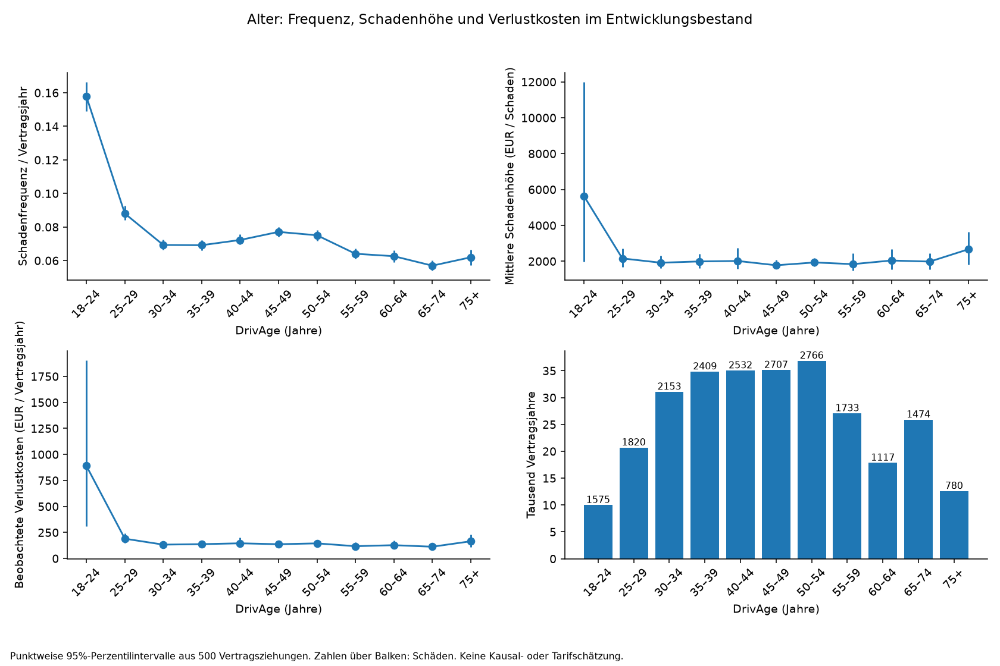
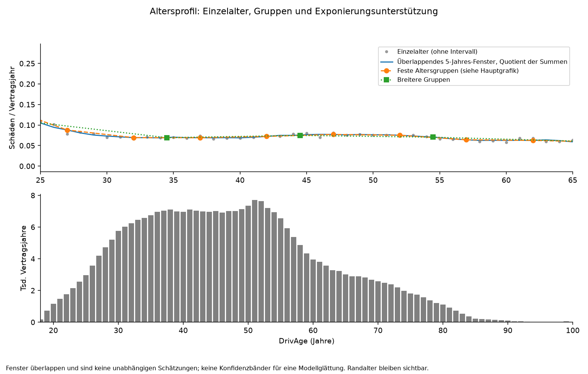
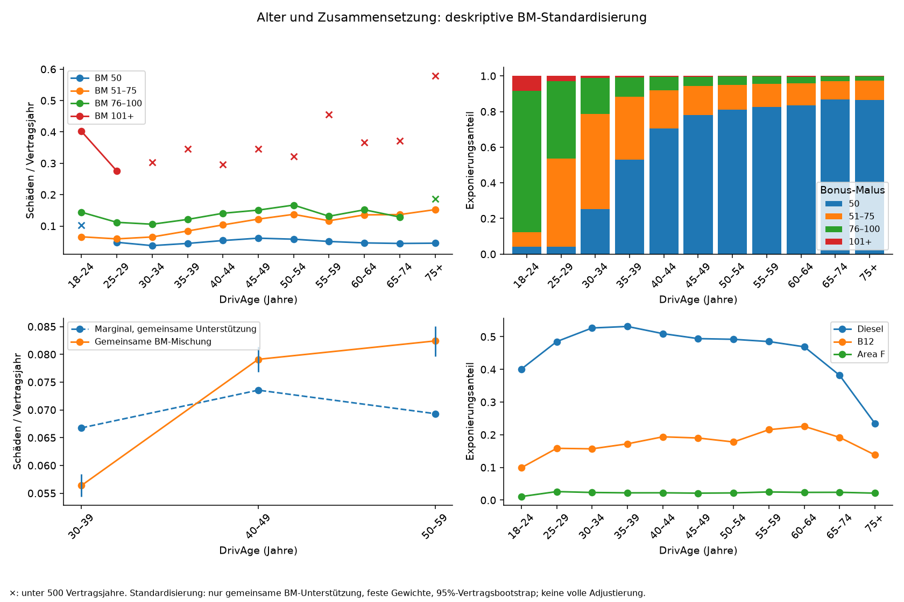
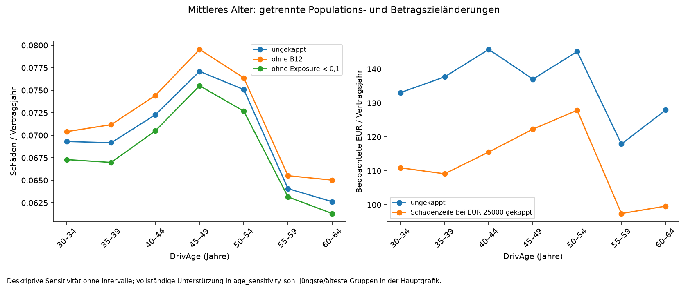

# Schadenfrequenz, Bestandsmix und große Verluste

Die Schadenfrequenz ist bei jungen eingetragenen Fahrern hoch, sinkt zunächst und steigt im mittleren Alter wieder an. Eine gemeinsame Bonus-Malus-Mischung verstärkt den deskriptiven Altersunterschied. Schadenhöhe und Verlustkosten folgen einer anderen, deutlich schwankenderen Kurve. Kurze Exponierungen und B12 kennzeichnen unterschiedliche Teilbestände; wenige große Schäden bestimmen einen erheblichen Teil des Gesamtverlusts. Daraus folgen konkrete Anforderungen an flexible Frequenzmodelle, gemeinsame Kompositionsdiagnostik und eine sorgfältige Schadenhöhenanalyse.

Diese Untersuchung verwendet ausschließlich die **542.392 Entwicklungsverträge** der festgelegten Aufteilung `s2split-fe11d414168572dd`: 286.880,818827 Vertragsjahre, 21.066 positive Schadenzeilen und 47.480.754,65 EUR. Quelle ist CASdatasets 1.2-1, Commit `227fb56b8734bdb7c0327a41180e01d2ddaeaf26`, Quellenkennung `cas-744e13a80283a07a`, Vorbereitung `s1-cb931cb73e410280`. Die aktuelle Laufkennung und sämtliche Prüfsummen stehen im [berechneten Nachweis](../reports/s3/eda_report.json). Historische Zahlen anderer Quellen werden nicht als Vergleichsergebnisse übernommen.

Die frühere Untersuchung des vollständigen Datenstands bleibt Teil der Analysegeschichte. Diese neue Exploration wertet keine Evaluationszeilen aus. Die zufällige Aufteilung ist weder zeitliche noch externe Validierung. Die Daten beschreiben einen französischen Bestand ungefähr 2011–2013; Beträge sind historische erfasste EUR, keine inflationsbereinigten heutigen deutschen Schadenkosten. [Anbieterbeschreibung](https://raw.githubusercontent.com/dutangc/CASdatasets/227fb56b8734bdb7c0327a41180e01d2ddaeaf26/man/freMTPL.Rd).

## Größen, Unterstützung und Unsicherheit

Für eine Gruppe gelten mit Anzahl `N`, Exponierung `e` und aggregiertem Betrag `S`:

- Frequenz: `sum N / sum e`, positive Schadenzeilen je Vertragsjahr.
- Schadenmittel: `sum S / sum N`, EUR je positiver Schadenzeile; bei null Schäden undefiniert.
- Beobachtete jährliche Verlustkosten: `sum S / sum e`, EUR je Vertragsjahr, einschließlich schadenfreier Verträge.

Das sind Quotienten von Summen. Der Mittelwert einzelner Jahresraten würde kurze Beobachtungen unangemessen stark gewichten. Beobachtet gilt exakt `Verlustkosten = Frequenz × Schadenmittel`, sofern Schäden vorhanden sind. Dies belegt weder die bedingte Erwartungsannahme eines späteren Frequenz-Schadenhöhenmodells noch eine Vorhersagegüte. Ein Mittel von Produkten lässt sich im Allgemeinen nicht durch das Produkt getrennter Mittel ersetzen. Hier gibt es **keine Prämienvorhersagen**; deren Zerlegung und Abgleich mit beobachteten Verlusten folgen erst mit den Frequenz-/Schadenhöhenmodellen.

Die gruppierten Merkmals- und Sensitivitätstabellen enthalten Vertrags-, Exponierungs-, Anzahl- und EUR-Summen. Unter 500 Vertragsjahren wird Unterstützung als gering markiert, nicht die Beobachtung gelöscht. Diese praktische Grenze garantiert keine ausreichende Schadenanzahl. Das [EDA-Protokoll](../config/eda_protocol.json) dokumentiert feste Gruppen, Fenster und Resampling. Die gemeinsame BM-Unterstützung wurde nach einer ersten Prüfung der Entwicklungsunterstützung festgelegt; dies ist explorative Methodenauswahl.

Die Haupt-Altersprofile und ihre vorab benannten benachbarten Kontraste verwenden **500 Vertragsbootstrap-Ziehungen**, Seed `20261031`, mit punktweisen 2,5-/97,5-Perzentilen. Exponierung, Anzahl und Gesamtverlust werden gemeinsam gezogen. So bleiben Nullverträge und alle Schäden desselben Vertrags zusammen. Ziehungen ohne Schäden liefern kein Schadenmittel; ihre Anzahl wird gespeichert. Die Standardisierung zieht innerhalb der Alters-/BM-Zellen und hält die Referenzgewichte fest. Es gibt keine simultanen Bänder, Modellneuanpassungen oder Korrektur für explorative Auswahl. Die begrenzte Zahl von Ziehungen erlaubt nur grobe Intervallendpunkte. Unbekannte Haushaltsabhängigkeit und nicht beobachtete Extremverluste erfasst dieser empirische Bootstrap nicht. [Methodische Referenz](https://docs.scipy.org/doc/scipy/reference/generated/scipy.stats.bootstrap.html).

Die übrigen Frequenztabellen enthalten zentrale 95%-Garwood-Intervalle als **Poisson-Referenz**: unabhängige Poisson-Anzahlen bei fester Exponierung. Überdispersion oder Abhängigkeit kann deren nominelle Deckung verletzen. Sie sind keine Konfidenzbänder einer geglätteten Alterskurve. Die Implementierung wurde einschließlich null Schäden gegen [statsmodels 0.15.0](https://www.statsmodels.org/stable/generated/statsmodels.stats.rates.confint_poisson.html) geprüft. Die überlappenden Fünfjahresfenster zeigen ausschließlich Quotienten der Summen ohne eigene Intervallbehauptung.

## Befund 1: Frequenz und Verlustkosten entwickeln sich über das Alter unterschiedlich

**Frage und Population.** Wie unterscheiden sich Schadenfrequenz, Schadenhöhe und jährlicher Verlust über `DrivAge`? Betrachtet werden alle Entwicklungsverträge, getrennt nach Einzelalter, festen etwa fünf- und zehnjährigen Gruppen und einem zentrierten Fünfjahresfenster.

| DrivAge | Verträge | Vertragsjahre | Schäden | Betrag EUR | Frequenz/Jahr | EUR/Schaden | EUR/Jahr |
|---|---:|---:|---:|---:|---:|---:|---:|
| 35–39 | 69.153 | 34.828,23 | 2.409 | 4.794.652,86 | 0,06917 | 1.990,31 | 137,67 |
| 40–44 | 67.279 | 35.030,41 | 2.532 | 5.107.067,13 | 0,07228 | 2.017,01 | 145,79 |
| 45–49 | 65.335 | 35.110,53 | 2.707 | 4.810.662,88 | 0,07710 | 1.777,12 | 137,01 |
| 50–54 | 65.905 | 36.840,18 | 2.766 | 5.348.014,43 | 0,07508 | 1.933,48 | 145,17 |

Die [vollständige Tabelle](../reports/s3/age_bootstrap.json) enthält die punktweisen Vertragsbootstrap-Intervalle. Die Frequenzdifferenz 40–44 minus 35–39 beträgt 0,00311 Schäden/Jahr, mit Intervall etwa [−0,00086; 0,00752]. Auch 45–49 minus 40–44 schließt null knapp ein. Diese lokalen Kontraste sind **nicht eindeutig**. Breitere Gruppen und Fenster erhalten die allgemeine Form: hohe Frequenz bei jungen Fahrern, Rückgang und ein breiter Wiederanstieg im mittleren Alter. [Kontraste](../reports/s3/age_contrasts.json), [Einzelalter](../reports/s3/DrivAge.json), [Fenster](../reports/s3/age_windows.json).



**Komposition, Alternativen und Identifizierbarkeit.** Die Unterstützung ist in den mittleren Gruppen groß, die Schadenhöhenintervalle bleiben wegen großer Schäden breit. Das Einzelalter 40 enthält einen Schaden von 774.411,50 EUR; nach einer Betragkappung verändert sich auch die Form des Verlustprofils. Im Gegensatz zur Frequenz zeigen die ungekappte Schadenhöhe und der Verlust pro Jahr keinen gleichmäßigen Anstieg von 35 bis 54. Einzelalterschwankungen oder eine vorhergesagte Prämienkurve sind daher keine austauschbaren Belege. Die [Alters-Sensitivität](../reports/s3/age_sensitivity.json) trennt Populationsänderungen von der EUR-25.000-Kappung jedes Schadenbetrags.

Die Alterssummen und die Einerstellenhäufigkeiten erlauben die Prüfung möglicher Häufungen, belegen aber keine Altersrundung: schon die Bestandszusammensetzung verändert solche Häufigkeiten. Es gibt nur zwei Entwicklungsverträge mit `DrivAge=100` und zusammen 0,89 Vertragsjahren ohne Schaden. Solche Randwerte werden erhalten, ohne daraus eine verlässliche Alterswirkung abzuleiten.

**Folgerung.** Der nicht monotone Verlauf spricht für eine flexible, nachvollziehbare Altersdarstellung in GLM und GAM. Die unterschiedliche Verlustkurve begründet eine getrennte Untersuchung der Schadenhöhe. Nächste überprüfbare Frage: Bleibt der breite Frequenzverlauf bei gemeinsamen Fahrzeug-, Kraftstoff- und geografischen Merkmalen auf unterstützten Beobachtungen bestehen? Das prüfen die späteren Modelle.



## Befund 2: Bonus-Malus verdeckt einen Teil des deskriptiven Altersunterschieds

**Frage und Population.** Erklärt wechselnde Zusammensetzung den marginalen Verlauf? Die Alters-Kreuztabellen zeigen Exponierungsanteile und Raten nach Bonus-Malus, Fahrzeugalter, Kraftstoff, Marke, `Area`, Dichte und allen 22 historischen Regionen. [Kompositionstabelle](../reports/s3/age_composition.json).

Eine direkte Standardisierung vergleicht 30–39, 40–49 und 50–59 auf derselben BM-Mischung. Gemeinsam unterstützt sind BM 50, 51–75 und 76–100; BM 101+ erreicht nicht in jeder Altersgruppe 500 Vertragsjahre. Dadurch entfallen ausschließlich für diesen Vergleich 1.382 / 671 / 485 Verträge mit 644,60 / 326,22 / 225,91 Vertragsjahren. Die ausgeschlossenen Schäden und EUR bleiben in der [Vergleichstabelle](../reports/s3/bm_standardized.json) sichtbar und im Primärbestand erhalten.

Die Referenzgewichte aus der gepoolten Exponierung sind 65,7501 % / 25,5218 % / 8,7282 %. Die marginalen Raten innerhalb dieser gemeinsamen Unterstützung betragen 0,06676 / 0,07355 / 0,06932. Bei derselben BM-Mischung betragen sie **0,05638 / 0,07910 / 0,08241**. Der Kontrast 40–49 minus 30–39 liegt bei 0,02272, mit punktweisem Intervall [0,02003; 0,02561]; für 50–59 minus 40–49 schließt das Intervall null ein. [Zellen und Gewichte](../reports/s3/bm_common_cells.json), [Kontraste](../reports/s3/bm_standardized_contrasts.json).



**Einordnung.** Die günstigere BM-Mischung älterer Gruppen verdeckt hier einen Teil der Unterschiede innerhalb der BM-Gruppen. Der Anstieg verschwindet bei dieser Standardisierung nicht. Dies ist eine **deskriptiv BM-standardisierte Assoziation**, keine vollständige Adjustierung und keine kausale Alterswirkung. BM ist mit Schadenhistorie und Alter verbunden; seine kausale Rolle ist durch diese Daten nicht geklärt. Innerhalb breiter BM-Gruppen verbleiben Unterschiede. Fahrzeug, Kraftstoff und Geografie sind noch nicht gemeinsam konstant gehalten.

Auch marginale Fahrzeug-/Gebietsmuster dürfen nicht als isolierte Wirkungen gelesen werden. Beispielsweise verändern sich zwischen 35–39 und 45–49 Dieselanteile von etwa 53,1 % auf 49,4 %, B12-Anteile von 17,2 % auf 19,0 %; die Anteile von `Ile-de-France` und `Area F` sind dort wesentlich ähnlicher. Die [Merkmalsprofile](../reports/s3/figures/portfolio_raten.png) zeigen Raten mit Exponierung und Poisson-Referenzintervallen. Die [Regionstabelle](../reports/s3/Region.json) markiert etwa `Franche-Comte` mit nur 456,05 Vertragsjahren als schwach unterstützt. Eine Marktkategorie oder höhere Dichte erklärt keinen individuellen Mechanismus.

**Folgerung.** BM bleibt ein substanzieller Kandidat; flexible additive Alter-/BM-Terme werden in S4 gemeinsam geprüft. Eine Alter-BM-Interaktion ist eine begründete Entwicklungsfrage, noch keine ausgewählte Konfiguration. Geografie und Fahrzeug-/Kraftstoffmischung benötigen gemeinsame Diagnostik; eine reine Randkurve genügt nicht.

**Mögliche Einordnung.** Die Daten sprechen dafür, dass die über das Alter wechselnde Schadenhistorie-/BM-Zusammensetzung einen Teil des marginalen Verlaufs überlagert. Unterschiede in Fahrleistung, Nutzung oder Erfassung könnten zusätzlich beitragen; sie werden hier nicht gemessen. Die Quelle beschreibt `DrivAge` als Fahreralter, ohne die Rolle beim einzelnen Schaden zu identifizieren. Eine plausible praktische Schlussfolgerung ist deshalb, Alter und BM gemeinsam zu modellieren und verbleibende Unterschiede zunächst als Vorhersagezusammenhänge zu behandeln. Für eine Erklärung durch individuelles Fahrverhalten wären zusätzliche Nutzungs- und Verlaufsdaten erforderlich.

## Befund 3: B12 ist auffällig, aber kein bestätigter Datenfehler

**Frage und Population.** Trägt B12 oder speziell B12 mit `VehAge=0` den Altersverlauf? Alle Marken und Alterswerte bleiben im Entwicklungsbestand. `VehAge=0` ist die Quellkodierung, kein belegtes Zulassungsdatum.

Die [Vierfeldertabelle](../reports/s3/b12_new.json) enthält für B12 bei Fahrzeugalter null 29.607 Verträge, 7.638,69 Vertragsjahre, 440 Schäden und Rate 0,05760. Bei anderen Marken mit Fahrzeugalter null sind es 16.479 Verträge, 5.708,34 Jahre und 474 Schäden, Rate 0,08304. Bei älteren Fahrzeugen liegen die Raten bei 0,06475 für B12 und 0,07539 für die übrigen Marken. Unterstützung und Poisson-Referenzintervalle sind gespeichert; dies sind marginale Unterschiede.

**Kompositionsprüfung und Alternativen.** Ein Ausschluss aller B12 entfernt 132.655 Verträge und 6.898.698,47 EUR; er erhöht die Gesamtrate um etwa 2,92 %. Nur B12 bei `VehAge=0` auszuschließen entfernt dagegen 29.607 Verträge und 927.090,07 EUR. Diese Eingriffe sind nicht dasselbe. Die [altersweisen Vierfelder](../reports/s3/age_b12_new.json) und Ausschlusssensitivitäten zeigen die Zusammensetzung; der mittlere Frequenzanstieg bleibt auch ohne B12 sichtbar. Produktmix, Nutzung und Kodierkonventionen bleiben mögliche, nicht identifizierte Alternativen.

**Folgerung.** Kein B12-Ausschluss als „Bereinigung“. Die Markenklasse und Fahrzeugalter bleiben Modellkandidaten. Ein späterer gemeinsamer Merkmalsvergleich kann prüfen, ob die marginale Differenz verbleibt; die unbekannte reale Marke wird nicht erfunden.

## Befund 4: Kurze Exponierung ist mehr als ein kleiner Nenner

**Frage und Population.** Sind kurze Perioden repräsentativ für eine bloß verkürzte Beobachtung derselben Jahresrate? Die [Exponierungsgruppen](../reports/s3/exposure_band.json) und [BM-Kreuztabellen](../reports/s3/exposure_bm.json) zeigen große marginale Unterschiede.

97.196 Verträge mit weniger als 0,1 Jahren tragen 5.534,52 Vertragsjahre, 935 Schäden und 3.344.594,18 EUR; ihre Rate beträgt 0,16894 statt 0,07343 insgesamt. Besonders hoch ist die Rate bei 1 bis unter 7 Tagen: 85 Schäden bei nur 74,04 Vertragsjahren. Eine Rate über eins ist mathematisch möglich und kein Schadenwahrscheinlichkeitsprozentsatz. Die Gruppe unter einem Tag hat 2.496 Verträge, aber nur 6,83 Jahre und zwei Schäden; ihre Unsicherheit ist entsprechend groß.

**Sensitivität und Identifizierbarkeit.** Ohne Perioden unter 0,1 Jahren sinkt die Gesamtrate um 2,56 % und der Verlust pro Jahr um 5,22 %. Der mittlere Altersverlauf bleibt in den deskriptiven Ausschlussszenarien sichtbar. 982 Verträge mit Exponierung über eins werden ebenfalls erhalten. Ein Kappen bei eins würde 115,30 Jahre entfernen und die Rate um 0,0402 % erhöhen. Die [Sensitivitätsbilanz](../reports/s3/sensitivities.json) weist alle Änderungen einzeln aus; sie dürfen nicht addiert werden.

**Folgerung.** Exponierungsproportionalität bleibt eine Modellannahme und muss in S4 diagnostiziert werden. Die Randraten allein beweisen keinen Offsetfehler: unterschiedlicher Risikomix, schadenabhängige Kündigung oder Beobachtungs-/Erfassungsprozesse könnten dieselbe Assoziation erzeugen. Daten über Beginn, Ende und Kündigungsgrund fehlen. Kein Ausschluss allein wegen hoher annualisierter Rate; Exponierung bleibt im Primärmodell Nenner bzw. Offset/Gewicht mit expliziter Einheit.

## Befund 5: Wenige Schadenbeträge dominieren die Verlustkosten

**Frage und Population.** Wie empfindlich sind Schadenmittel und Verlustkosten gegenüber dem oberen Rand? Alle 21.066 Entwicklungs-Schadenzeilen bleiben erhalten, einschließlich 195 exakt wiederholter Vertrags-/Betragszeilen. Ohne echte Schaden-ID belegen gleiche Beträge keine Dublette. Die mitgelieferte und rekonstruierte Anzahl unterscheiden sich bei keinem Entwicklungsvertrag.

Der größte Betrag von 4.075.400,56 EUR entspricht **8,58 %** des Gesamtverlusts und gehört zu einem Vertrag mit eingetragenem `DrivAge=19`. Die größten 100 Zeilen tragen 32,90 %, die größten 211 Zeilen (rund 1 %) 38,04 %. [Konzentration](../reports/s3/tail_concentration.json), [Quantile](../reports/s3/claim_quantiles.json), [Altersunterstützung der zehn größten Beträge](../reports/s3/top_loss_age_support.json). Hier werden Schadenzeilen sortiert, keine Frequenz-Gini oder Kausalwirkung berechnet.

Eine Kappung jeder Zeile bei 25.000 EUR entfernt 13.227.184,49 EUR bzw. **27,86 %**; der beobachtete Jahresverlust sinkt von 165,51 auf 119,40 EUR. Anzahl und Exponierung bleiben gleich, das Betragsziel ändert sich. Die [altersweise Betragssensitivität](../reports/s3/age_loss_sensitivity.json) zeigt, warum eine Frequenzkurve keine Verlustkurve ersetzt. Eine Anzahlkappung bei vier entfernt wiederum 39 Anzahlen und passt nicht mehr zu den ursprünglichen Schadenzeilen; dafür wird kein vermeintlich konsistentes Schadenmittel ausgewiesen.

**Unsicherheit, Alternativen und Folgerung.** Die Vertragsbootstrap-Intervalle erfassen Wiederholung oder Ausbleiben beobachteter großer Beträge, aber keine bislang unbeobachteten Extremverluste. Auch Abrechnungs- und Meldekonventionen können die Beträge beeinflussen. Ein hoher Betrag ist kein belegter Fehler. Das ungekappte Ziel bleibt primär; S5 muss Tail-Einfluss und einen konstanten Schadenmittel-Benchmark offen gegen komplexere Modelle prüfen. Eine Kappung darf nur als gesonderte Zielgröße mit EUR-Bilanz interpretiert werden, nicht als automatisch besseres Modell.



## Reproduzieren und weiter prüfen

Nach Vorbereitung und Festlegung der S2-Aufteilung:

```powershell
.\.venv\Scripts\python.exe -m src.eda
.\.venv\Scripts\python.exe -m unittest discover -s tests -v
.\.venv\Scripts\python.exe scripts/execute_notebook.py notebooks/03_development_eda.ipynb --output data/notebooks/03_development_eda.executed.ipynb
```

Der Befehl erstellt lokale unveränderliche Parquet-Tabellen unter `data/eda/<Laufkennung>/` und öffentliche aggregierte JSON-Tabellen/Grafiken unter `reports/s3/`. Quelle, Vorbereitung, Split, Entwicklungstabellen, EDA-Code, Konfiguration und Software identifizieren den Lauf. Das Notebook prüft lokale Tabellen, öffentliche Spiegel und Bild-Hashes, bevor es Ergebnisse anzeigt; es verändert keine Aufteilung und passt kein Modell an. Wiederholungen müssen dieselben Ergebnisbytes erzeugen. Nur die dokumentierte Windows-x64-/Python-3.12-Umgebung ist tatsächlich geprüft.

Die Tests adressieren unter anderem absichtlich vergiftete Evaluationswerte, Schlüsselvertauschung, Schaden-/EUR-Erhaltung, wiederholte Schadenzeilen, Nullschäden, Intervallreferenzen, gepaarte Vertragsziehungen, fehlende gemeinsame Unterstützung und manipulierte Ergebnisartefakte. Es wurden keine Evaluationsmodelle oder Evaluationsscores erzeugt. Die nächste Untersuchung ist der begrenzte gemeinsame GLM-/GAM-/Histogramm-Poisson-Vergleich auf den festgelegten Entwicklungsfalten. Die hier begründeten Fragen sind keine schon bestätigten Gewinner oder Modellterme.
