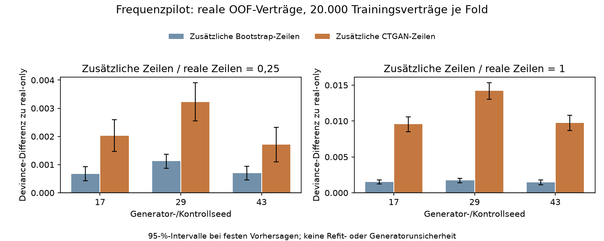

# Synthetische Trainingsverträge: begrenzter CTGAN-Pilot

Die Augmentation wird für diesen Pilot verworfen. Die vorab festgelegte Bedingung eines über beide Ratios und alle drei Seeds konsistenten Vorteils gegenüber beiden Kontrollen ist nicht erfüllt. Alle sechs CTGAN-Varianten verschlechtern die reale OOF-Deviance gegenüber beiden Kontrollen; gegenüber real-only beträgt die Verschlechterung 0,37–3,06 %. Die Kernmodellwahl bleibt unverändert. Dieser Vergleich betrifft einen Poisson-GLM mit jeweils 20.000 realen Trainingsverträgen; er prüft keine Augmentation des vollständigen Trainingsbestands.

## Tatsächlicher Vergleich

Die fünf bestehenden Entwicklungsfolds liefern 542.392 reale OOF-Verträge mit 286880,82 Vertragsjahren und 21.066 erfassten positiven Schäden. Pro Fold wird einmal ein festes, ergebnisunabhängig zufällig gezogenes Trainingssubset von 20.000 Verträgen aus den übrigen vier Folds gewählt. Alle Methoden und Generatorseeds verwenden dasselbe Subset. Die Basisdeviance beträgt **0,464386 je Vertragsjahr**, A/P **1,0073**. Diese Basis ist wegen der begrenzten Trainingsmenge kein Ersatz für das vollständige S4-Ergebnis.

| Ratio | Seed | Bootstrap-Deviance | CTGAN-Deviance | CTGAN − real-only | CTGAN − Bootstrap | CTGAN A/P |
|---:|---:|---:|---:|---:|---:|---:|
| 0,25 | 17 | 0,465062 | 0,466417 | 0,002031 | 0,001355 | 0,9975 |
| 0,25 | 29 | 0,465509 | 0,467615 | 0,003229 | 0,002105 | 0,9253 |
| 0,25 | 43 | 0,465081 | 0,466095 | 0,001709 | 0,001014 | 0,9223 |
| 1,00 | 17 | 0,465899 | 0,473940 | 0,009555 | 0,008041 | 0,9495 |
| 1,00 | 29 | 0,466095 | 0,478595 | 0,014210 | 0,012500 | 0,8211 |
| 1,00 | 43 | 0,465840 | 0,474129 | 0,009743 | 0,008289 | 0,8349 |



Kleinere Deviance ist besser; negative Differenzen sprechen für die jeweils zuerst genannte Methode. Die Fehlerbalken zeigen die unten erläuterten konditionalen 95-%-Intervalle. A/P ist tatsächliche geteilt durch prognostizierte Schadenanzahl. Die Tabelle umfasst 13 vollständige OOF-Varianten. Je Ratio/Seed stehen zusätzliche gewöhnliche Bootstrap-Zeilen als Kontrolle neben CTGAN. Der GLM bleibt auf die frühere GLM-Spezifikation mit Alters-BM-Interaktion und alpha=0,0001 festgelegt. Eine Modellauswahl über die hier betrachteten Varianten findet nicht statt.

## Verfahren und Abgrenzung zur Originalstudie

[Xu et al. (2019), Modeling Tabular Data using Conditional GAN](https://proceedings.neurips.cc/paper_files/paper/2019/file/254ed7d2de3b23ab10936522dd547b78-Paper.pdf) modellieren gemischte Tabellen: Eine variationale Gaußmischung repräsentiert numerische Werte durch Komponente und normierten Abstand innerhalb der Komponente. Kategoriale Spalten erhalten One-Hot-Darstellungen. Der Generator verwendet Zufallsrauschen und eine Kategorienbedingung. Beim Training werden seltene Kategorien über logarithmische Häufigkeiten häufiger berücksichtigt. Eine zusätzliche Kreuzentropie bestraft verletzte Bedingungen. Der Critic unterscheidet reale und generierte Zeilengruppen; WGAN-Verlust und Gradientenstrafe stabilisieren dieses Gegenspiel.

Für einen numerischen Wert c und die gezogene Mischungskomponente k lautet der skalierte Abstand (c − mu_k) / (4 sigma_k); zusätzlich wird k kodiert. Die Zuordnung erfolgt anhand der trainierten Mischungswahrscheinlichkeiten. Damit wird kein global normalverteilter Versicherungsbestand vorausgesetzt. Erforderlich bleibt, dass die trainierte gemeinsame Verteilung für den gewünschten realen Vorhersagebestand informativ ist.

Im verwendeten [Release 0.11.1](https://github.com/sdv-dev/CTGAN/tree/v0.11.1) minimiert der Critic schematisch E[C(fake)] − E[C(real)] + Gradientenstrafe, der Generator −E[C(fake)] + bedingte Kreuzentropie; hinzu kommen die registrierten Optimiererparameter. Die Funktion sample_original_condvec verwendet entgegen ihrem Namen dieselben logarithmischen Kategorienwahrscheinlichkeiten wie beim Training. Der explizite Adapter restore_natural_sampling setzt diese nach dem Fit anhand der gespeicherten Trainingszeilenindizes auf natürliche empirische Häufigkeiten zurück; Training und Daten bleiben unverändert. Vorher-/Nachher-Wahrscheinlichkeiten werden gespeichert und getestet. Das garantiert keine korrekte gemeinsame Verteilung. Alle diskreten Merkmale einschließlich Anzahl werden als Kategorien gelernt; nur Density und Exposure sind kontinuierlich. Eine kleinere Architektur mit 128 statt 256 Einheiten und 30 statt 300 Epochen begrenzt den Pilot. Es wird keine Generator-Konvergenz behauptet. Die Originalstudie ersetzt Trainingsdaten; hier wird zusätzliches Material untersucht.

[TabDDPM (Kotelnikov et al., 2023)](https://proceedings.mlr.press/v202/kotelnikov23a.html) ist eine veröffentlichte Diffusionsalternative für gemischte Tabellen. Deren allgemeine Benchmarkbefunde entscheiden diese exponierungsgewichtete Versicherungsfrage nicht; eine zweite Generatorfamilie wurde nicht implementiert.

## Trainingsgrenzen, Einheiten und Strafe

CTGAN sieht ausschließlich neun prospektive Merkmale, positive Exposure und recorded_positive_count aus dem jeweiligen Trainingssubset. Reale Vertragskennungen, Fold-/Splitkennungen, Schadenbeträge und Modellvorhersagen fehlen im Generatoreingang. Synthetische Zeilen besitzen eigene Kennungen und Herkunft zum Lauf, Seed, ausgeschlossenen Fold und Hash der realen Trainingskennungen. Sie gelangen ausschließlich ins Training. Alle Normalisierer, Kategorien und GLM-Designparameter werden dort gelernt. Reale Validierungsmerkmale fließen erst in predict ein.

Die Antwort ist Anzahl / Exposure; Gewichte sind Exposure. Kombinierte Gewichte werden global auf die reale Trainings-Exponierung normiert. Der GLM normiert seine Likelihood bereits durch die Gewichtssumme: Die globale Skalierung verändert sein alpha deshalb nicht. Eine vollständige Verdoppelung identischer Zeilen liefert im Regressionstest dieselben Vorhersagen. Bei gewöhnlichem Bootstrap ändern sich relative Gewichte zufällig; genau dieser Effekt dient als Kontrolle. Eine Ratio bezeichnet zusätzliche Zeilen, keinen gleichen Anteil an Vertragsjahren. Die tatsächlichen zusätzlichen Exponierungen sind im lokalen Fit-Audit gespeichert.

## Qualität der synthetischen Zeilen

Innerhalb der festen Budgets wurden 15 Generatoren ausgeführt. Von 600.000 Kandidaten wurden 102.152 verworfen (17,03 %); Gründe können sich überschneiden. Es gibt kein nachträgliches Runden oder Clipping. Diskrete Werte müssen im Trainingssupport liegen; Density und Exposure müssen endlich, positiv und innerhalb der jeweiligen Trainingsbereiche sein. Dichte wird vor der Transformation explizit als float übergeben. Die Auswahl nimmt die ersten gültigen Zeilen aus höchstens doppelt so vielen Kandidaten wie benötigt. Diese Ablehnung verändert ihrerseits die generierte Verteilung und wird deshalb offengelegt.

Die Nullanteile der akzeptierten vollständigen synthetischen Samples reichen von 0,9052–0,9687; Anteile mit mindestens zwei Schäden von 0,0014–0,0032; jährliche Schadenraten von 0,0594–0,1650. Exponierungsquantile, Anzahl/Exponierungs-Zusammenhang, Ratenextreme, Alters-/BM-Support, sämtliche Kategorienhäufigkeiten und unbeobachtete Area/Region-, Alter/BM- und Marke/Kraftstoff-Paarungen sind je Generator im Ergebnis-JSON ausgewiesen. Unbeobachtete Paarungen sind kein Nachweis physischer Unmöglichkeit und werden nicht pauschal verworfen.

Der Hashvergleich findet 0 exakte vollständige Trainingszeilen unter den akzeptierten vollständigen synthetischen Samples. Auch null exakte Treffer belegen weder fehlende ungefähre Memorierung noch Datenschutz. Der Pilot besitzt keine Differential-Privacy-Garantie. Neue Zeilen sind keine neue unabhängige Informationsquelle.

Eine nach der ersten Generatorausgabe ergänzte [Diagnostik des gemeinsamen Supports](../reports/o2/joint_support.json) zählt zusätzlich Kombinationen von Area und Density außerhalb des für dieselbe Area beobachteten Trainingsbereichs. Ihr Anteil liegt über die Generatoren bei **73,77–80,40 %**. Das zeigt eine Schwäche der gemeinsamen Verteilung; die empirischen Subset-Grenzen sind kein Beweis physischer Unmöglichkeit. Die Diagnose verändert weder gültige Zeilen noch Fits, Entscheidung oder Hyperparameter. Ein zusätzlicher Nähecheck findet 0 Zeilen mit identischer vollständiger diskreter Signatur und höchstens 0,001 Abstand in beiden durch Trainingsbereiche skalierten Koordinaten logDensity und Exposure zu einer Trainingszeile. Auch diese operationalisierte Ähnlichkeit ist keine Datenschutzprüfung.

## Unsicherheit und Entscheidung

Der [Bericht](../reports/o2/report.json) enthält gepaarte Verlustdifferenzen samt konditionalen 95-%-Intervallen und alle fünf Fold-Ergebnisse; [Segmenttabellen](../reports/o2/segments.json) zeigen Area, Alter, Bonus-Malus und Vertragsdauer. Für feste Vorhersagen ist Delta = sum(d_neu − d_basis) / sum(Exposure). Das asymptotische Intervall verwendet die über reale Policen streuenden Beiträge (d_neu − d_basis − Delta × Exposure). Refit-, Generator- und Modellauswahlunsicherheit sind darin nicht enthalten. Seed- und Foldstreuung werden gesondert gelesen; überlappende Trainingsfolds sind keine unabhängigen Wiederholungen. Unbekannte Haushaltsabhängigkeit bleibt offen.

Der bereits für den Kernvergleich betrachtete Evaluationsbestand wird hier nicht ausgewertet. Es gibt keinen zusätzlichen vorab reservierten Bestätigungsbestand. Die Untersuchung ist explorativ; eine neue Zufallsaufteilung wäre kein frischer externer Nachweis. Das Ergebnis gilt für dieses Trainingsbudget, diese diskrete Kodierung, diese Architektur, 30 Epochen und den festgelegten GLM. Es widerlegt oder bestätigt CTGAN nicht allgemein und erlaubt keine Aussagen über synthetische Schadenhöhen oder Risikoprämien.

## Reproduktion und Aufwand

```powershell
python -m venv data/o2/venv
data/o2/venv/Scripts/python.exe -m pip install -r requirements-o2.lock.txt
data/o2/venv/Scripts/python.exe -m src.augmentation
data/o2/venv/Scripts/python.exe scripts/augmentation_support_diagnostics.py
data/o2/venv/Scripts/python.exe scripts/build_augmentation_results.py
data/o2/venv/Scripts/python.exe scripts/verify_augmentation.py
```

Voraussetzung sind der vorhandene S1-Datenbestand und die unveränderte S2-Aufteilung. Die optionale Umgebung ist von der Kernumgebung getrennt. Ein identischer Laufpfad wird nicht überschrieben; für eine vollständige Wiederholung muss ein separates Checkout mit vorbereitetem Bestand verwendet werden. Pro Generator gelten 300 Sekunden für Prozessstart, Fit und Sampling; nach 7.200 Sekunden startet kein weiterer Generator. Fehler werden gespeichert, ohne Ersatzseeds oder zusätzliche Suche.

Gemessen: 1614,5 Sekunden für den Analyselauf, davon 1320,9 Sekunden Generatorfits; Installation, nachgelagerte Verifikation und Darstellung sind darin nicht enthalten. Verwendet wurden CPU mit zwei Torch-/BLAS-Threads, CPython 3.12.10, torch 2.9.0 und CTGAN 0.11.1; kein GPU-Fit. Lauf **o2-b71e81d7f2c7a4fe**. Der Bericht enthält Quell-/Konfigurations-/Daten-/Splithashes und Abhängigkeiten; vollständige lokale Gewichte, Kandidaten, synthetische Zeilen und keyed OOF-Vorhersagen liegen ausgeschlossen unter data/o2/. Öffentlich werden aggregierte Ergebnisse bereitgestellt.
